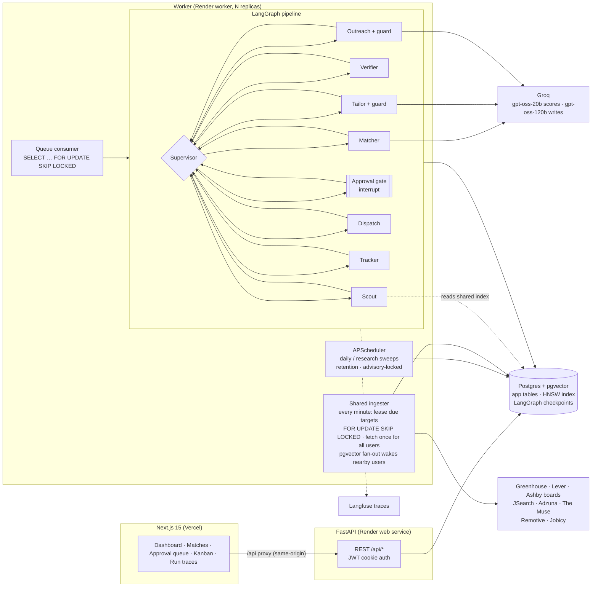

# JobPilot — a multi-agent internship hunter

Upload your resume once. Every morning a team of agents pulls **real, currently-open** internships and entry-level
roles (technical and non-technical) from company career boards and public job APIs, scores how well each one fits you,
asks you about skill gaps on near-misses, rewrites your resume bullets for the best matches, drafts a short cold email
and LinkedIn note, and tracks everything you've applied to. **Nothing is sent until you approve it.**

- **Nine agents, one supervisor** orchestrated with LangGraph, checkpointed in Postgres
- **Continuous research**: the Researcher discovers companies that hire for your profile (LLM suggestions + public
  feeds + a catalog, verified against live career-board APIs) and the whole team re-runs every few hours; new matches
  arrive as in-app / desktop notifications and, optionally, an email
- **Tailored resume per job** (PDF + DOCX): your uploaded resume with job-relevant skills first, the Tailor's bullets,
  and skills you confirmed — never a skill you don't have
- **Real jobs only**: Greenhouse, Lever and Ashby career boards (Stripe, Databricks, HackerRank, Paytm, Sarvam, …),
  The Muse, Remotive, Jobicy and Adzuna. Postings a source stops listing are hidden as closed.
- **Skill check**: when your resume nearly fits, the Interviewer asks whether you have the missing skills; a "yes" in
  your own words is added to your profile and those jobs are re-scored and tailored
- **One-click apply by email**: with SMTP set up (e.g. a Gmail app password), **Approve & send** emails the recruiter
  from your address with the tailored resume PDF attached. Without it, approving opens the draft in Gmail or your mail
  app. **Apply on site** opens the company's real application page with your tailored bullets copied
- **No fabricated skills**: every rewrite is checked by a guard; anything that adds a tool, a claim or a number is reverted
- **Evals** for match quality and fabrication, **per-agent cost and latency** on the dashboard, **retries and fallbacks** throughout
- **Built to scale**: job sources are fetched once for *all* users (shared ingestion) and only the users a new posting
  could fit are woken up, so outbound traffic stays flat as users grow (≈75 requests/min at 1,000 or 10,000 users)
- **Quality over volume** (from our competitive research): a weekly *quality budget* so only the strongest fits are
  prepared, a **referral request** with every application (plus an alumni search link), a **ghost-job radar** that
  never applies to old, reposted or unverifiable listings, and a transparent quality gate on every match
- **Proof-of-skills pack**: GitHub (ownership verified via a bio code), Codeforces (official APIs), projects and
  certificates on a public proof page linked in every draft; job skills your evidence proves are marked
- **Outcomes & feedback loop**: record replies, interviews, offers and rejections; Insights shows interview rate,
  A/B resume-version conversion, conversion by fit band / source / track, and the gaps behind rejections
- **Campus mode**: on-campus drives with automatic eligibility (CGPA, branch, backlogs, batch), round-by-round prep,
  internship-to-PPO tracking, one timeline with off-campus applications, and a **placement-cell dashboard** for colleges
  (per-student detail only with the student's consent)
- **WhatsApp daily digest** (official Cloud API, consent-based, STOP to opt out) and a **Chrome autofill extension**
  for Greenhouse / Lever / Ashby forms that never clicks Submit (`extension/`)
- **DPDP-ready consent**: an itemized notice per purpose (matching, sending, proof page, WhatsApp, campus sharing,
  ledger), each a separate switch with a record of when, how and which notice version; rights requests and a public
  grievance form with a 30-day reply date; an 18+ age gate; inactive accounts deleted after 12 months with notice;
  a breach-response runbook (`docs/breach-response.md`)
- **Scam Shield** (`/scam-check`, `POST /api/scam-check`, no sign-in): paste a WhatsApp / Telegram / email offer, a
  link or an offer letter (PDF, or an image via Tesseract OCR) and get a verdict (Likely safe / Suspicious / Likely
  scam), a risk score, evidence per check (fees, UPI IDs, free-mail recruiters, lookalike and newly registered domains,
  "selected without interview", implausible pay, urgency, OTP / ID requests, chat-only hiring, task scams, fake
  government internships) in English, Hindi, Marathi and Hinglish, what to do (cybercrime.gov.in, 1930) and a share
  card for WhatsApp. Nothing pasted is stored; "report this scam" keeps a redacted copy only with consent. Labelled set:
  48 cases + 12 held-out (`evals/data/scam_*.jsonl`)
- **Verifier v2**: the same checks on every posting at ingest, plus a 0-100 ghost-job score (age, reposts, last seen,
  ATS open status, careers-page presence); every job carries a verification row, "Likely scam" postings never reach the
  queue and the API refuses to approve or send them
- **Claim provenance (guard v2)**: every tailored bullet cites its sources (resume lines, ownership-verified GitHub
  repos, linked proof items) and shows them as chips in the review queue; a bullet with no source, or with a skill,
  tool or number its sources don't contain, is reverted with the reason logged. A property test injects 400 fake
  claims and requires 100% to be reverted
- **Quality quota**: 5 approved sends a day by default (adjustable up to the plan's max, Free 10), enforced
  server-side and reset at midnight IST; a 0-100 send-worthiness score (fit, verification, ghost score,
  completeness) on every draft; an audit event for every approve / reject / send with its channel; a Monday report
  "we skipped N weak or risky matches for you" by email and WhatsApp
- **Signed Proof Links**: every approved application (with a published proof page) gets `/p/{slug}/{token}`: verified
  GitHub ownership, Codeforces rating, projects, certificates, "Human-approved by the student on …", applications
  sent that week and the claim-provenance badge. The payload is Ed25519-signed; recruiters check it at
  `/api/v1/verify/{token}` (public key at `/api/v1/verify/public-key`). Tampered tokens fail, students can revoke a
  link, and opens are logged server-side (no pixels), shown in the Tracker and notified once
- **India sources, no ToS-violating scraping**: a `sources` registry with per-source ToS notes and rate limits
  (LinkedIn, Internshala, Naukri, Unstop, Indeed, Glassdoor, Wellfound listed as never used); a careers-page watcher
  that reads only schema.org JobPosting JSON-LD, obeys robots.txt and makes at most one request a minute per domain;
  community internship lists on GitHub (SimplifyJobs JSON); government portals as deep links; job-board alert
  emails forwarded to a private inbound address and pasted links, kept as links the student opens. Dedupe by company,
  normalised title and location (the same role on several boards becomes one job with several apply links)
- **WhatsApp approvals + languages**: the morning digest is followed by the best 3-5 drafts with Approve / Edit in
  app / Skip buttons (signed per student, 24-hour expiry, voided by "sign out everywhere"); approvals pass the same
  scam block and daily quota as the web and are audited with channel `whatsapp`; webhook retries are idempotent; STOP
  opts out. English / हिन्दी / मराठी for WhatsApp messages and the app's main labels (Settings → Language; the Scam
  Shield page has its own switch)
- **Payments (Razorpay)**: Pro ₹299/month (UPI AutoPay or card, a Subscription), a ₹79 Week Pass and a ₹2,499 Year
  Pass (one-time, by UPI QR or a Payment Link); a `/billing` page compares week vs month vs year, and Free accounts see
  Get Pro / Week Pass buttons on the dashboard on Razorpay's hosted pages; webhooks verified (HMAC) and idempotent by event id; sequential GST-ready invoices
  (tax invoice with a GSTIN, receipt without); cancel in two clicks (Pro lasts to the end of the paid period); an
  hourly sweep lapses expired plans. Students can also pay by scanning a single-use UPI QR in Settings (Week Pass, or
one month of Pro without renewal), confirmed by the `qr_code.credited` webhook with an amount check. An experimental "₹99 on first interview" plan asks (never charges) when an
  interview is recorded with evidence; off until `OUTCOME_PLAN_ENABLED=true`
- **Stipend & PPO ledger**: students report stipend, duration, mode, PPO and paid-on-time under the `ledger` consent,
  verified by a college-email code or an offer letter that's stored encrypted only until a moderator checks it (then
  deleted, hash kept); company aggregates only with 3+ published reports; outliers wait in a moderation queue; the
  Verifier flags stipends far from what students report
- **JD-specific mock interviews**: 8-12 questions from the job description's own lines and the student's projects,
  typed or spoken (browser speech recognition), scored on relevance / specificity / structure with feedback quoting the
  JD line; skills shown convincingly can be added in the student's own words, which re-scores the job
- **Gap-to-proof**: a 48-hour mini-project spec for near-miss gaps; a submitted repo is checked on GitHub's public API
  (owned by the verified account, pushed in the last 7 days, uses the skill) and the match is re-scored with before →
  after recorded in a run trace
- **Campus v2 (tier-2/3 colleges)**: a drive-circular parser (pasted WhatsApp text or PDF → company, role, CTC /
  stipend, CGPA / % / branches / backlogs / batch, deadline, rounds; 20 labelled circulars at 100% field accuracy after
  tuning, 5 held-out at 98%) that notifies eligible consenting students when the drive is posted; consent enforced by
  Postgres row-level security (a restrictive policy on profiles, job_matches and drive_statuses inside an officer
  context: only students with an active `college_share` consent are visible, withdrawal applies immediately); an
  audit event for every officer data view; alumni referrals only from alumni who consented
- **Transparency report** (`/transparency`): monthly totals from a daily `transparency_daily` rollup (postings
  verified, scams blocked, scam checks, applications approved, average ₹ AI cost per run)
- **Sign in with Google** on the login and register pages (`openid email profile` only, no Gmail access): state bound
  to the browser, signing up still requires the 18+ and privacy-notice confirmations, and an existing account with the
  same verified email is linked
- **Gmail via Google sign-in**: send-only access (`gmail.send`), refresh token encrypted, sends spaced 90 s apart,
  an opt-out line on every application; app passwords remain for other providers
- **Production basics**: per-user mailboxes (encrypted), Free / Pro plan limits and a daily AI budget per user,
  rate limiting shared across replicas, revocable sessions, password reset, data export and deletion (DPDP / GDPR),
  a public landing page with a one-click demo, an admin dashboard, Sentry, CSP / HSTS and a retention sweep
- **Honest landing page and `/trust`**: live beta counters from `GET /api/public/stats` (postings verified, scams
  blocked, applications approved, average ₹ AI cost per run from run traces; demo accounts excluded, cached 5 minutes,
  no made-up stories), and a `/trust` page listing what we check, what we never do, the data we store, DPDP rights,
  the grievance contact and subprocessors

> Company applicant-tracking systems (Greenhouse, Lever, Ashby) don't offer a public "submit application" API, so the
> final submit happens on the company's site. JobPilot gets you there with everything prepared and records it.

---

## Architecture



### The agents

| Agent | What it does | Model |
|---|---|---|
| **Supervisor** | Picks the next agent from shared state; skips (and records) agents with nothing to do. Deterministic on purpose: reproducible, free, easy to test. | — |
| **Researcher** | Once a day per user: asks the LLM for companies that hire your profile, adds companies seen in public feeds and a catalog, and checks each against the Greenhouse / Lever / Ashby APIs. Boards with roles you could take (India, or remote open to India) are added to your search; you see and can remove them in Settings. The scheduler re-runs the full team every `research_interval_hours`. | gpt-oss-20b |
| **Scout** | Reads the **shared job index**: open jobs nearest your resume (HNSW), through your own filters (internships / entry-level, technical / non-technical, India or remote-open-to-India, freshness, keywords) that you haven't seen. Makes sure your boards and searches are in the index and fetches any that are due, so a new account's first run finds jobs at once. Fetching itself is shared (see *Shared ingestion*). | — |
| **Verifier** | Checks every new job is legitimate before it's scored: a named employer, no requests to pay for training, kits or certificates, no WhatsApp/Telegram-only hiring, a live apply link on the company's careers system or site, no personal-email recruiters or pressure language, plausible internship pay, and the ghost-job signals. Each job gets a verdict (verified · caution · suspicious) with its reasons; suspicious jobs never reach the Matcher. Verdicts are shared across users for a day. | gpt-oss-20b (second opinion on the most doubtful few only) |
| **Matcher** | Blends three signals: pgvector cosine similarity, skill coverage from a shared lexicon, and a recruiter-style review of the top-K by the cheap model. Produces “Strong: Flask, scikit-learn. Missing: Docker, SQL.” | gpt-oss-20b |
| **Interviewer** | For near-miss jobs (just under your bar, or rated close by the LLM review) it asks about the concrete skills you're missing, ranked by how many jobs each would unlock. Answering re-scores those jobs in a follow-up run. | gpt-oss-20b |
| **Tailor** | Rephrases the 4–6 most relevant bullets for each shortlisted job. Each rewrite cites its source bullet id; the guard reverts any rewrite that adds a skill, moves a tool between roles, or changes a number. | gpt-oss-120b |
| **Outreach** | 4–5 line email + <300-char LinkedIn note, built only from the tailored bullets. Same guard; a failing draft falls back to a template. | gpt-oss-120b |
| **Approval gate** | LangGraph `interrupt()`. The run shows *Needs approval* until the queue for that run is empty, then the worker resumes it. | — |
| **Dispatch** | Emails approved drafts from **your own mailbox** (connected in Settings, password encrypted) with the tailored resume attached; otherwise you send from Gmail / your mail app with one click. | — |
| **Tracker** | Kanban stages (Found → Shortlisted → Applied → Interview → Offer), and a follow-up reminder 7 days after applying. Also runs as an hourly sweep. | — |

### Shared ingestion (how it scales)

Every company board, public feed and aggregator search that any active user wants is a row in `source_targets`, with
how many users want it and the widest filter any of them needs. Each minute every worker leases a slice of due targets
(`UPDATE … WHERE id IN (SELECT … FOR UPDATE SKIP LOCKED)`), fetches them, runs the scam filter and the apply-link check,
de-duplicates across boards, embeds and stores each posting **once**, then runs one pgvector query to find the users
whose resume is close to a new job and queues a refresh run only for them (Pro instantly, Free at most every 15 min).
Quota APIs (JSearch, Adzuna) get **one** monthly budget for the whole service, spent on the most-wanted searches.

```text
$ uv run python -m scripts.scale_check        # real target planner, synthetic users
   users |  per-user fetching | shared ingestion | distinct targets | saving
      10 |            110/min |           26/min |               68 | 4x fewer
     100 |          1,174/min |           74/min |              167 | 16x fewer
   1,000 |         11,745/min |           75/min |              169 | 156x fewer
  10,000 |        118,402/min |           75/min |              169 | 1,576x fewer

$ uv run python -m scripts.load_test 200 50   # one dev API process on a laptop, agents running alongside
1,000 requests from 200 users (50 at a time) in 2.8s → 357 req/s, 0 errors
/api/stats/overview  p50 146ms  p95 395ms   ·   /api/matches  p50 124ms  p95 371ms
```

### Engineering choices worth calling out

- **Postgres is the only stateful dependency.** It holds app data, vectors (HNSW, cosine), LangGraph checkpoints, and the
  work queue. Workers claim runs with `FOR UPDATE SKIP LOCKED`, so you scale by adding replicas; the scheduler takes a
  transaction-scoped advisory lock so only one replica enqueues daily runs.
- **Runs are resumable.** `execute_run` inspects the checkpoint: no checkpoint → start; paused at the interrupt → resume;
  mid-graph (crash or failure) → continue from the last completed agent. *Retry* in the UI re-queues the same thread.
- **LLM failure policy** (`app/llm.py`): strict structured outputs (a JSON schema with every field required and
  `$ref`s inlined, as Groq's strict mode needs) → validate with Pydantic → on bad or truncated JSON, or Groq's
  "does not match the expected schema" 400, re-ask with the error attached (up to 2 repairs, doubling the token budget
  on truncation) → on API failure after the SDK's retries (429 / 5xx / network), raise `LLMUnavailable` and the agent
  uses its deterministic path. The provider is a setting; the Claude path also opts into server-side refusal fallbacks.
- **Cost accounting.** Every call is written to `llm_calls` (tokens, cache reads, cost, latency, attempts) and rolled up
  per run and per agent. Run latency counts *active* time only, not hours spent waiting for your approval.
- **One active run per user**, idempotent reminder creation, unique constraints instead of check-then-insert.
- **Plans and cost control.** Free / Pro limits (tailored drafts, on-demand runs, refresh speed) and a per-user daily AI
  budget; past the budget every agent falls back to its deterministic offline path instead of failing.
- **Security.** Rate limits live in Postgres so they hold across replicas; JWTs carry a `token_version` (password change
  or "sign out everywhere" ends every older session); single-use hashed reset tokens; Fernet-encrypted mail passwords;
  CSP, HSTS and `no-store` on API answers; production refuses to boot with default secrets.
- **Demo mode without cost.** "Try the live demo" clones a showcase account (real matched jobs, tailored resumes,
  drafts) into a private throwaway account that can't send mail and is deleted after 24 hours: no LLM call per visitor.

---

## Evals

```bash
make eval        # offline: matcher (embeddings + skills) and guard — free, runs in CI
make eval-llm    # adds LLM fit reviews and the live Tailor fabrication rate (uses API credits)
```

1. **Match quality**: 20 postings hand-labelled 1–3 for the sample resume (`backend/evals/data/match_labels.json`).
   Reports Spearman ρ, precision@5 and bucket accuracy. Rate jobs ★1–5 in the UI and export them from
   `GET /api/matches/export/labels` to grow the set with your own judgment.
2. **No-fabrication guard**: 12 adversarial rewrites (invented tools, changed metrics, tools moved between roles,
   legitimate rephrasings) in `guard_cases.json`. Measures guard precision and recall.
3. **Tailor (`--llm`)**: share of raw LLM rewrites the guard had to revert, and violations after the guard (must be 0).

Latest results (sample resume, 20 postings):

| Metric | Offline (bge-small + skills) | With Groq reviews (gpt-oss-20b) |
|---|---|---|
| Spearman ρ vs. my labels | 0.83 | **0.86** |
| Precision@5 | 0.80 | 0.80 |
| Bucket accuracy | 0.65 | 0.75 |
| Guard precision / recall | **1.00 / 1.00** (15 cases) | — |
| Tailor rewrites reverted by guard (gpt-oss-120b) | — | 2 / 25, both false positives ("40k" → "40,000"), since fixed and added to the guard cases |
| Violations after guard | — | **0** |

A live run on the sample resume (7 new postings → 5 tailored resumes + 5 drafts, 17 LLM calls) costs about
**$0.007** at Groq's list prices; the full `--llm` eval costs about $0.006.

---

## Run it locally

Requirements: Python 3.12+, [uv](https://docs.astral.sh/uv/), Node 22+, Postgres 16+ with the `vector` extension
(`brew install pgvector`, or use Docker).

```bash
cp backend/.env.example backend/.env      # optionally add GROQ_API_KEY, ADZUNA_APP_ID/KEY
make setup                                 # deps, databases, migrations
make seed                                  # showcase account with the sample resume (demo visitors get a copy)
make api                                   # http://localhost:8000  (API + embedded worker)
make web                                   # http://localhost:3000
```

Open http://localhost:3000 for the landing page and **Try the live demo**, sign in with the account from
`backend/.env.example`, or register and upload `samples/sample_resume.md`. Make yourself an admin with
`uv run python -m scripts.set_plan you@example.com admin` to open `/admin`.
Click **Run agents** and watch the pipeline; review drafts in **Approvals**; drag cards on the **Tracker**.

Everything in containers (Postgres + API + 2 workers + web):

```bash
docker compose up --build
```

Tests (real Postgres, offline LLM, hash embeddings; covers auth, the full HITL pipeline, resume/retry, source failures,
LLM repair and fallback, the guard, follow-ups):

```bash
make test
```

---

## Deploy

Render (API, workers, Postgres) + Vercel (web). Step-by-step, with every environment variable, in **[DEPLOY.md](DEPLOY.md)**.

---

### Voice answers: Flowtype in the mock interview

Spoken interview answers use **Flowtype**, the dictation engine from the Flowtype desktop app (`flowtype/`), built on
Wispr Flow's published principles (`backend/app/dictation/`, `frontend/lib/flow/`):

- **Capture:** hold Right Ctrl (Right Option on a Mac) or the Speak button; double-tap for hands-free. 16 kHz mono with a
  500 ms pre-roll ring buffer and 250 ms post-roll; energy VAD trims silence and sends nothing when no speech was heard;
  peak-normalised, with extra gain for quiet voices.
- **Context-biased ASR:** Whisper's prompt (≤224 tokens, natural sentences, no instructions) carries the question's terms
  and your dictionary (name, college, employers, projects, skills, and words you add), most important last.
- **Context:** the company, role and round, and the answer around the cursor: names and terms already in your answer
  are spelled the same way, your own words are Whisper's style sample, a take dictated mid-sentence continues it, and
  a coding round keeps identifiers as code ("get user by id" → getUserById).
- **Guards (tuned on live Groq output):** silent, low-confidence (avg_logprob < −1.0; Groq's turbo model reports
  no_speech_prob = 0 even on noise), looping and stock-phrase segments dropped; a loop or the prompt echoed back retries
  once without the prompt; ASR falls back to a second model on timeout.
- **Long answers while you talk:** at a natural pause after 4+ s, the finished stretch is transcribed in the background
  (`POST /api/stt/chunk`), so at release only the last few seconds are left (a 17.5 s answer: text 1.1 s after
  release, polished).
- **Spoken formatting:** "new paragraph" and "new line" become breaks.
- **Learning:** when you submit, a word you corrected after dictating ("Aishan" → Ishaan) is learned, compared in memory
  and never stored as text; the next dictation spells it your way. Learned words are listed (and removable) under
  "A word still comes out wrong?".
- **Fixes:** term spellings and a sound-alike match to your dictionary (Double Metaphone + spelling + an Indian-name sound
  key), then by mode:
  - **Polished** (default): an LLM clean-up (`app/dictation/cleanup.py`) removes fillers and false starts, resolves
    self-corrections ("Flask, no wait, FastAPI" → FastAPI), adds punctuation, numbered lists and written numbers, and
    never answers the question. A guardrail validator rejects any rewrite that changes more than 35% of the words,
    falls outside 0.5–1.3× the length, adds a name or number nobody said, or reads like a reply ("four thirty" → 4:30
    and spelling fixes that sound like what was said, "fast API" → FastAPI, are allowed). Rejections, time-outs
    (600 ms) and rate limits fall back to the plain text with only um / uh / stutters removed. "Use my exact words"
    undoes a clean-up.
  - **Word for word:** an AI pass that may only swap in a dictionary word that sounds like what was heard, within a
    600 ms budget (short answers skip it).
- **Metrics, no text:** per-stage latency (p50/p95), the Dictation Edit Rate per mode, and the clean-up's
  accepted / guard-rejected / timed-out rates (`GET /api/stt/metrics`); no audio or
  transcript is stored. Frontend unit tests: `npm run test:unit` in `frontend/`.

### Campus v2: colleges of any field, at 40 lakh students

Campus mode (`backend/app/campus/`, `frontend/app/(app)/campus/**`, `/campus-profile`) works for any college:
engineering, medical, law, commerce, arts, nursing, design, ITI or a foreign university. See
`docs/campus-v2-plan.md`, and for measured scale results `docs/campus-load-test.md`.

- **Structure as data:**
  - fields are UNESCO ISCED-F 2013, levels are ISCED 2011, and degrees come from AISHE 2015-16 plus common international ones;
  - each college has its own grading scale (never converted), its own label for pending subjects (backlog, ATKT, KT…) and its own student-ID label;
  - eligibility rules are data, evaluated in background jobs.
- **Staff-only portal (`/campus/**`):** joining needs a staff code (locks after 5 wrong tries), an institutional-email OTP (personal domains refused) and TPO approval. TPOs and Principals use 2FA. Every login, view, approval, verification and export is audit-logged.
- **Students (`/campus-profile`):** they claim the roster the college imported, or pick a programme for staff to confirm. They add only internships, roles and awards, with proof. Entries stay Self-reported until verified, and editing resets them.
- **Database enforcement:**
  - row-level security runs on per-transaction settings (no subqueries), under the `jobpilot_campus` role;
  - large tables are hash-partitioned (32), the audit log by month;
  - ids are UUIDv7;
  - lists use keyset pagination, dashboards are pre-aggregated, and imports and eligibility run as Postgres-queue jobs.
- **Scale scripts:** `scripts/seed_scale.py` (40 lakh), `scripts/explain_campus.py` (plans under RLS), `scripts/loadtest_campus.py`.
- **Reference data:** rebuilt from the AISHE export with `python -m scripts.import_aishe "<folder>"`.

## Configuration

| Variable | Default | Purpose |
|---|---|---|
| `LLM_PROVIDER` | `groq` | `groq` or `anthropic` |
| `GROQ_API_KEY` | — | Enables Groq. Without a key for the chosen provider, agents run offline. |
| `ANTHROPIC_API_KEY` | — | Used when `LLM_PROVIDER=anthropic` |
| `STT_MODEL` | `whisper-large-v3-turbo` | Dictation ASR model on Groq (fallback: `whisper-large-v3`) |
| `STT_TIMEOUT_S` | `6.0` | ASR timeout before the fallback model is tried |
| `STT_AI_BUDGET_MS` | `600` | Time budget for the AI spelling pass; past it the deterministic text is used |
| `STT_CLEANUP_MODEL` | `qwen/qwen3.8-27b` | Polished-mode clean-up model (reasoning off via `STT_CLEANUP_REASONING=none`) |
| `STT_CLEANUP_FALLBACK_MODEL` | `openai/gpt-oss-20b` | Used while the first model is rate-limited (`STT_CLEANUP_FALLBACK_REASONING=low`) |
| `STT_CLEANUP_BUDGET_MS` | `600` | Clean-up time budget; past it the filler-stripped text is used |
| `CAMPUS_PARTITIONS` | `32` | Hash partitions per large campus table, read when migration 0030 runs (tests use 4) |
| `FAST_MODEL` / `SMART_MODEL` | Groq: `openai/gpt-oss-20b` / `openai/gpt-oss-120b`<br/>Claude: `claude-haiku-5-5` / `claude-opus-5-5` | Scoring vs. writing models (empty = provider default) |
| `LLM_CONCURRENCY` | 4 | Parallel LLM calls per process |
| `EMBEDDING_BACKEND` | `fastembed` | `fastembed` (local bge-small, 384-d) or `hash` (tests) |
| `ADZUNA_APP_ID` / `ADZUNA_APP_KEY` | — | Adzuna search API ([free key](https://developer.adzuna.com/)) |
| `DEMO_SOURCE` | `true` | Include 20 bundled sample postings (fictional companies) |
| `EMBEDDED_WORKER` | `true` | Run queue consumer + scheduler inside the API process |
| `WORKER_CONCURRENCY` | 2 | Runs processed in parallel per worker |
| `SMTP_*` | — | **System** mail only (password resets, alerts). Applications go from each user's own mailbox. |
| `ENCRYPTION_KEY` | — (required in prod) | Fernet key that encrypts users' mail passwords |
| `APP_URL` | `http://localhost:3000` | Public web origin, used in password-reset links |
| `ADMIN_EMAILS` | — | Comma-separated accounts that can open `/admin` |
| `JSEARCH_API_KEY` | — | JSearch (LinkedIn, Indeed, Glassdoor, Naukri, Wellfound via Google for Jobs) |
| `HUNTER_API_KEY` | — | Hunter.io: real, publicly sourced contacts at a company |
| `SENTRY_DSN` | — | Error reporting for API and workers (no personal data sent) |
| `DEMO_TEMPLATE_EMAIL` | `demo@example.com` | The showcase account demo visitors get a copy of |
| `FANOUT_MIN_SEMANTIC` | 15 | How close (0–100) a new job must be to a resume to wake that user's agents |
| `INGEST_MAX_TARGETS_PER_TICK` | 120 | Targets each worker fetches per minute |
| `GITHUB_TOKEN` | — | Raises GitHub's API limit for proof packs (60 → 5,000 requests / hour) |
| `WHATSAPP_TOKEN` / `WHATSAPP_PHONE_NUMBER_ID` / `WHATSAPP_TEMPLATE` / `WHATSAPP_TEMPLATE_LANG` / `WHATSAPP_APP_SECRET` / `WHATSAPP_VERIFY_TOKEN` | — | WhatsApp Cloud API daily digest (off until set) |
| `EXTENSION_ORIGIN_REGEX` | `chrome-extension://[a-p]{32}` | Origins allowed to call the API with an extension token |
| `LANGFUSE_*` | — | Trace every agent step and LLM call in Langfuse (timings, tokens, cost; never prompts or outputs) |
| `GOOGLE_CLIENT_ID` / `GOOGLE_CLIENT_SECRET` | — | Gmail sending through Google sign-in (`gmail.send` only); see DEPLOY.md |
| `SEND_SPACING_S` | 90 | Minimum seconds between two sends from one mailbox |
| `INACTIVE_DELETE_DAYS` / `INACTIVE_NOTICE_DAYS` | 365 / 30 | Delete unused accounts after a year, with a notice a month before |
| `SCAM_FETCH_URLS` / `SCAM_RDAP_ENABLED` | `true` | Scam Shield fetches pasted links (public hosts only) and looks up domain age over RDAP |
| `SCAM_LLM_DAILY_CAP` | 300 | AI second opinions per day across all anonymous scam checks |
| `PROOF_SIGNING_KEY` | derived from `ENCRYPTION_KEY` | Ed25519 seed (32 bytes, base64url) that signs Proof Links |
| `GITHUB_LISTINGS_URLS` | SimplifyJobs Summer 2026 | Comma-separated public internship-list JSON URLs (empty turns it off) |
| `INBOUND_EMAIL_DOMAIN` / `INBOUND_EMAIL_SECRET` | — | Forwarded job-alert emails (see DEPLOY.md) |
| `USD_INR_RATE` | 88.0 | Rupees per US dollar, used to show AI cost (billed in USD) in ₹ on the landing page |

Web (Vercel) variables, all optional except `API_URL`: `API_URL` (the API origin), `NEXT_PUBLIC_SITE_URL` (canonical
origin for a custom domain; defaults to Vercel's production domain), `NEXT_PUBLIC_CONTACT_EMAIL`,
`NEXT_PUBLIC_GRIEVANCE_OFFICER` and `NEXT_PUBLIC_GRIEVANCE_EMAIL` (shown on `/trust`, `/privacy` and `/terms`).

Per-user search preferences (keywords, locations, internships-only, minimum fit score, Greenhouse/Lever boards,
daily run hour) live in **Settings**.

---

## Project layout

```
backend/
  app/
    agents/       supervisor graph, researcher, scout, verifier, matcher, interviewer, tailor, guard, outreach, approval/dispatch, tracker
    api/routes/   auth, account (mail, usage, export/delete), admin, profile, matches, drafts, runs, stats, public (landing counters), events (SSE)
    sources/      Greenhouse, Lever, Ashby, JSearch, Adzuna, The Muse, Remotive, Jobicy, demo feed; authenticity checks
    services/     ingest (shared fetching + fan-out), job_store, run queue, events, mailer, ratelimit, usage, demo, retention
    llm.py        Groq / Claude wrapper: strict structured output, repair, cost accounting
    embeddings.py fastembed / hash embedders
    skills.py     skill lexicon shared by matcher, guard and parser
    worker.py     queue consumer + APScheduler
  alembic/        migrations
  evals/          eval sets + runner
  tests/          pytest suite
extension/        Chrome MV3 autofill extension (Greenhouse, Lever, Ashby) + field-mapping tests
frontend/
  app/(marketing)/ landing page, scam-check, trust, transparency, privacy, terms
  app/p/[slug]/    public proof-of-skills page
  app/(app)/      dashboard, jobs, jobs/[id], approvals, skills, tracker, insights, campus, college, proof, runs, settings, admin
  app/(auth)/     login, register, forgot-password, reset-password
  components/     shell, pipeline timeline, match rows, charts, UI kit
  lib/            API client, React Query hooks, types
```

Job data comes only from official or public APIs. LinkedIn is not scraped.
